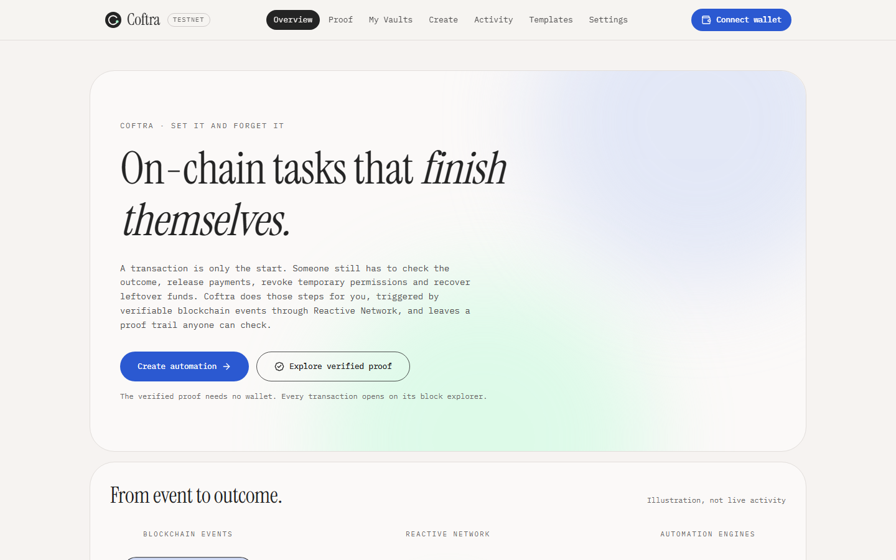
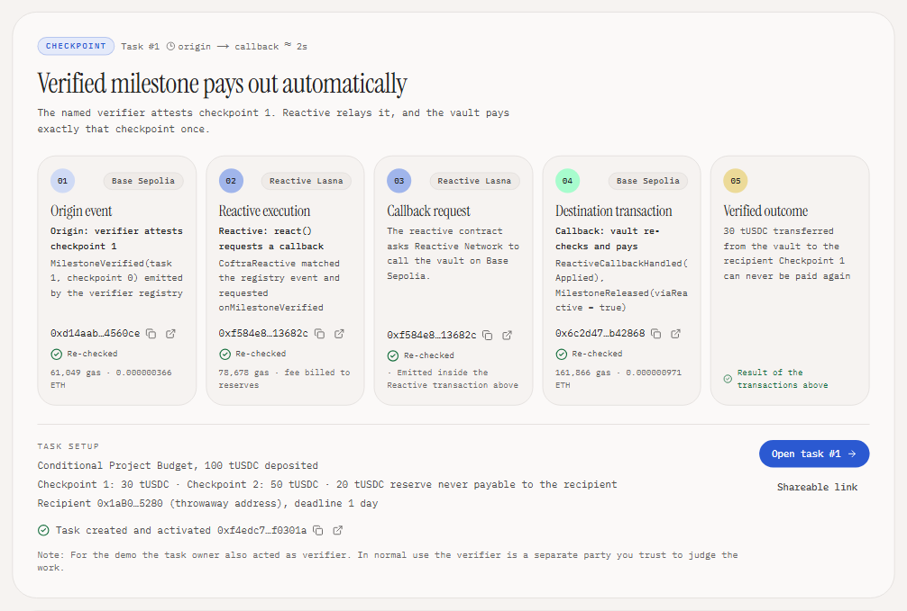
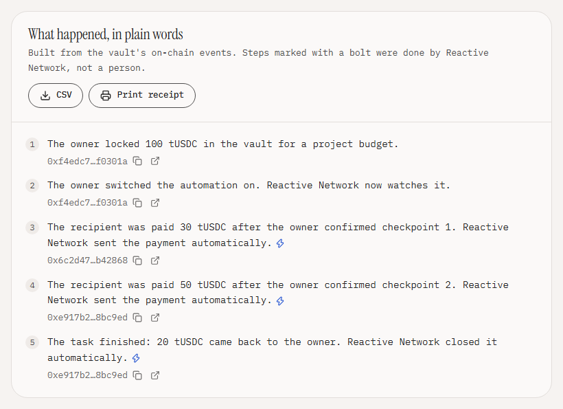
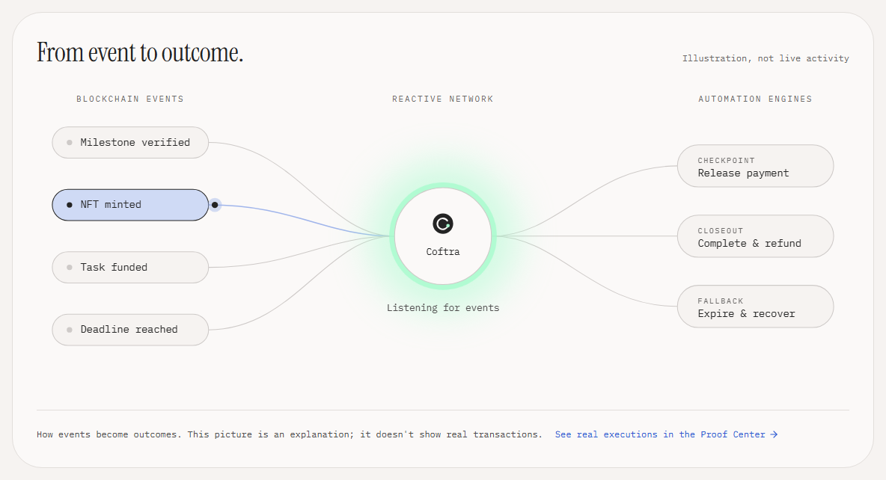
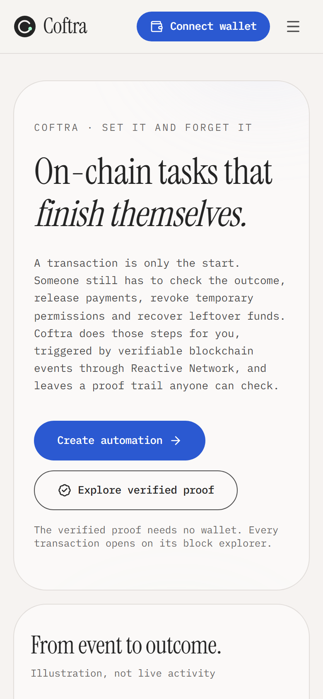

# Coftra

Most on-chain tasks don't end when the transaction is sent. Someone still has to check the outcome, manage permissions, release payments or recover leftover funds. Coftra automates those steps using verifiable blockchain events.

You fund a task, set its rules, and close the tab. [Reactive Network](https://dev.reactive.network/) watches for the events that matter, and a self-custodial vault applies the outcome: it releases a milestone, closes a spending session, or returns what's left when the deadline passes. Every step leaves a proof trail you can open on a block explorer.

**Live app:** https://web-two-pied-ft7sms1616.vercel.app/ · **Proof Center, no wallet needed:** [/proof](https://web-two-pied-ft7sms1616.vercel.app/proof) · **Judges:** [5-minute quickstart](docs/JUDGE_QUICKSTART.md)



> **Status:** testnet only (Base Sepolia + Reactive Lasna). Contracts are deployed, and CHECKPOINT, CLOSEOUT and FALLBACK are each proven end to end on testnet, each loop taking about 1–3 s from origin to callback. See [docs/IMPLEMENTATION_STATUS.md](docs/IMPLEMENTATION_STATUS.md). Not audited. Don't use it with real funds.
>
> More: [failure & recovery evidence](docs/FAILURE_RECOVERY.md) · [how Coftra differs](docs/DIFFERENTIATION.md) · [security review](docs/security/SECURITY_REVIEW.md)

## Who it helps

- **People paying in stages:** grant programs, DAOs, and clients of freelancers. Money is released per verified milestone, and the reserve comes back automatically.
- **People delegating one action:** a bot minting an NFT for you, for example. It gets a capped, single-purpose budget that shuts off by itself once the job is done.

## The three engines

| Engine | Trigger | What the vault does |
|---|---|---|
| **CHECKPOINT** | The named verifier calls `attest()` on the registry | Re-checks verifier, config version and deadline, then pays exactly that milestone, once |
| **CLOSEOUT** | Last milestone released, or the paid-for NFT is minted to you | Revokes the executor, settles accounting, returns unspent funds |
| **FALLBACK** | A Reactive Cron tick after the deadline | Re-checks the deadline on Base Sepolia, freezes payouts, keeps completed ones, returns the rest |

All three share one lifecycle (`Funded → Active → Completed | Expired | Cancelled`) and one exit path in the contract. See [ARCHITECTURE.md](docs/architecture/ARCHITECTURE.md).

## How Reactive Network does the work

```
Base Sepolia                      Reactive Lasna                         Base Sepolia
──────────────                    ───────────────                        ──────────────
Registry: MilestoneVerified ─┐
DemoNFT: Transfer(0, you, id) ─┼─► CoftraReactive.react()  ─ requestCallbackV_1_0 ─►  callback proxy
Vault: TaskActivated/Closed ──┘     ├ relays attestations / mints                       └► CoftraVault.onX(rvmId, …)
                     Cron tick ───► ├ keeps an index of open deadlines                     re-validates, applies or
                                    └ on cron: requests expiry checks                      records why not
```

- **Essential, not decorative.** Nobody has to be online when a deadline passes or a mint lands. Without Reactive, someone would run a keeper bot. With it, the browser and any server are optional.
- **Authenticated.** Callbacks must come from the official proxy and carry our RC's address (`onlyServiceProvider` + `onlyCallbackSender`). Subscriptions are pinned to specific emitters.
- **Idempotent and acknowledged.** Duplicate deliveries are no-ops. Because the network doesn't retry callbacks, the RC re-requests overdue expiries until it sees the vault's `TaskClosed`.
- **Cheap when idle.** The RC subscribes to cron only while a task is open.

## What makes it different

- **Proof Center.** Each automated step is rebuilt from chain data alone: origin tx → Lasna reactive tx → destination tx, with result, balance changes and costs. There's no indexer, and nothing simulated.
- **Safety Preview.** The rule is shown in plain language before you sign, generated from the same values the contract will enforce. Approvals are always exact amounts.
- **Funding Health.** Live balances and debts on both chains, with labelled cost estimates. Activation is blocked when automation couldn't run.
- **Never stuck.** The owner can release a milestone directly, and anyone can run the fallback by hand 30 minutes after a deadline.

## What you can do in the app

**See it work, without a wallet.** The Proof Center shows each of the four recorded runs as five stages: origin event, Reactive execution, callback request, destination transaction and verified outcome. Every receipt is re-checked on both chains when the page opens, and every hash opens on Basescan or Reactscan.



**Understand a rule before you sign it.** The Rule Builder shows the rule as WHEN / THEN / OTHERWISE, runs a safety inspector, and lists "What will happen": every case the rule allows and where the money ends up in each. All three are built from the same values the contract call uses.

**Read a task's history in plain words.** Each task page tells its story from the vault's events, and marks the steps Reactive Network did with a bolt. You can download it as a CSV (exact amounts, transaction hashes, explorer links) or print it as a receipt.



**See it from the other side.** My Vaults has a "Paying me" tab (what you were promised, what's paid, what's still to come) and an "I can spend" tab (what's left in a session you may spend from). On a project budget, "Copy link for the recipient" shares the task page with an explanation written for the person being paid, who needs no wallet to follow along.

**Know what needs you.** The Overview lists open tasks most urgent first, including tasks where you're a verifier. While Coftra is open, a small pop-up appears when Reactive Network acts on one of your tasks. It's built from real vault events, never for your own manual actions.

**Reuse what works.** Save a rule as a template at the Review step, or from a task you own, and start the next one in one click. Name the addresses you deal with in Settings → Contacts. Export the history of all your tasks as one CSV from My Vaults.

Task names, contacts and templates live only in your browser. Nothing is sent anywhere, and every screen still shows the real address next to a name.

**How it works, at a glance.** The homepage's animated pipeline shows events flowing through Reactive Network to the three engines. It's an illustration, not live data: real runs are in the Proof Center.



**Design.** A parchment, editorial look: Instrument Serif headings and IBM Plex Mono text, both open-source (OFL). It's light by default, with an optional warm dark theme in Settings. The public pages were checked at phone width (375 px) with no sideways scrolling.



## Repository

```
contracts/   Foundry: src/, test/ (unit, fuzz, invariant), script/Deploy.s.sol
apps/web/    Next.js 16 + wagmi/viem + TanStack Query + Tailwind
docs/        architecture/, security/, deployment/, demo/, IMPLEMENTATION_STATUS.md
```

## Run locally

```bash
git clone --recursive <repo> && cd coftra/contracts && forge build && forge test
```

```bash
cd apps/web && pnpm install && pnpm sync:contracts && pnpm dev
```

Without a deployment record, the app shows its explanatory pages and says that no live data exists. It never shows placeholder numbers.

## Deploy

Four steps across two chains, using a keystore account. See [docs/deployment/DEPLOY.md](docs/deployment/DEPLOY.md). The demo transactions are in [docs/demo/DEMO.md](docs/demo/DEMO.md).

## Tests

41 Foundry tests (`forge test`):
- **Scenarios:** every engine, callback authentication, forged emitters, duplicate events, completion/expiry races, failed transfers, cross-task isolation, fee-on-transfer rejection, manual recovery.
- **Fuzz:** conservation of funds, deadline boundaries, spend bounds, random callbacks.
- **Invariants:** solvency, liability accounting, single settlement, caps, and RC index consistency, all run through a simulated Reactive pipeline.

Web app (`cd apps/web`):
- **53 Vitest unit tests:** recorded evidence, the WHEN / THEN / OTHERWISE diagram, the safety inspector, the "What will happen" cases, task stories and CSV receipts, recipient and executor views, templates, contacts, the "What needs you" list and pop-up detection.
- **2 fork tests:** the builder's exact calldata run against the live contracts on a local fork of Base Sepolia (`COFTRA_FORK_RPC=… pnpm test`). They're skipped without a fork RPC.
- **`pnpm verify:proofs`:** 60 read-only checks that re-verify the four recorded loops from raw chain data.

Slither runs in CI, along with TypeScript, ESLint and a production build.

## Live evidence

Deployed on Base Sepolia (vault `0x2335A6D769bb3f6E6D4B1a48f6926A81aEA5b719`) and Reactive Lasna (reactive contract `0x17B29bC8400FB88de4c885Af4335983cd09c3D96`).

| Workflow | Origin | Reactive tx (Lasna) | Destination callback (Base Sepolia) | Outcome |
|---|---|---|---|---|
| CHECKPOINT | [`0xd14aab…`](https://sepolia.basescan.org/tx/0xd14aab0c1ba0d840139b1b6e0d97491e464581b0c3435ff5995876037f4560ce) attestation | [`0xf584e8…`](https://lasna.reactscan.net/tx/0xf584e835f25d1fd4e5d3d24c44ef8169248fd2245d676eff0427e94c1d13682c) | [`0x6c2d47…`](https://sepolia.basescan.org/tx/0x6c2d47492b3a67cfae829059840563e11816097fc562b3c14374a36109b42868) | 30 tUSDC released to the recipient |
| CLOSEOUT (project) | [`0x4330a5…`](https://sepolia.basescan.org/tx/0x4330a5abe5a213614a0213510f666475028cbce361e499a3013ef53aed7d4846) last checkpoint attested | [`0xae198b…`](https://lasna.reactscan.net/tx/0xae198bcdaae3c6b8e992f5607413cf0adb83a17081557987a84a6e7153552311) | [`0xe917b2…`](https://sepolia.basescan.org/tx/0xe917b2f438bdf9ebac2bf2a63cb85df473093a1fabe0d0c8a1217c29a28bc9ed) | Task completed, 20 tUSDC reserve returned, cron switched off |
| FALLBACK | [`0x612b3e…`](https://lasna.reactscan.net/tx/0x612b3e7c48e85f5ea33681fce1c6e8afb6555290929733a1423b909208a2b5e6) Cron tick | [`0x5c48cd…`](https://lasna.reactscan.net/tx/0x5c48cda6f98fd703c6b0562dca07def027df9be65f035826c70f8e59cb25fb49) | [`0x00f052…`](https://sepolia.basescan.org/tx/0x00f052cdfd2f5f5e6eab4338610b1bef9702ef8ef8f833b57d85467761a0bf21) | Task expired with nobody online; 20 tUSDC returned |
| CLOSEOUT | [`0x0cb519…`](https://sepolia.basescan.org/tx/0x0cb519ee7ed7a9894a790ce0a8c2cd34ac8e6fc6f738ba13d453173e0503f99f) bot mints the NFT | [`0x1c03e0…`](https://lasna.reactscan.net/tx/0x1c03e0d5b22b94df6008bd788f3988b71c84f4ff156418e3702304030c8deba4) | [`0xd26d20…`](https://sepolia.basescan.org/tx/0xd26d202b13f207173a73fff75a96c149370c5e12c89dee186add4eeb24b9c5fa) | Session closed, bot revoked, 15 tUSDC returned, owner holds the NFT |

Full details and how each hop was verified: [IMPLEMENTATION_STATUS.md](docs/IMPLEMENTATION_STATUS.md#verified-evidence).

## Security

There's an internal review and threat model in [docs/security/SECURITY_REVIEW.md](docs/security/SECURITY_REVIEW.md); three issues were found and fixed. Trust assumptions:
- Milestone verifiers are trusted for their own milestones.
- The vault admin can only pause new tasks, manage the token allow-list, and withdraw native callback-gas funds. The admin can never touch task balances.

There has been no independent audit.

## Future work

- k-of-n verifiers.
- Optional email or Telegram alerts (needs a small read-only watcher service).
- Per-session dynamic subscriptions.
- Verifier registries on other chains.
- More vetted session targets.
- An independent audit before any mainnet use.

More in [docs/ROADMAP.md](docs/ROADMAP.md).

## Tech stack

Solidity 0.8.30, Foundry, OpenZeppelin 5.4, reactive-lib-omni · Next.js 16, TypeScript (strict), Tailwind 4, wagmi 2, viem 2, TanStack Query 5, lucide · Instrument Serif and IBM Plex Mono (OFL, self-hosted through `next/font`).
