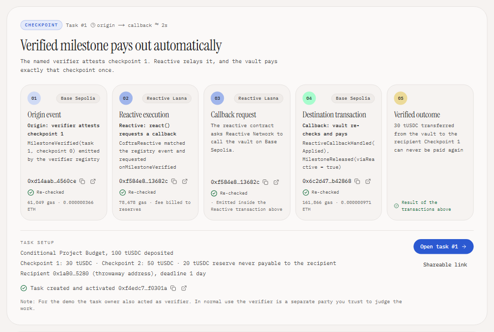

# Coftra: 5-minute judge quickstart

**Coftra** lets you fund an on-chain task and leave. The task can be a budget paid out milestone by milestone, or a bot allowed to spend a capped amount on one action. Reactive Network watches for the events that matter: a verifier's attestation, an NFT mint by a contract Coftra doesn't control, or a deadline passing. It asks the vault to act, and the vault re-checks its own rules, then pays, closes the task and revokes temporary permissions, or refunds what's left. Nobody needs to stay online, and nothing runs on a server.

- **Live app:** https://web-two-pied-ft7sms1616.vercel.app/
- **Proof Center (no wallet needed):** https://web-two-pied-ft7sms1616.vercel.app/proof
- **Source:** https://github.com/Chima30/coftra
- **Track:** Set It and Forget It · **Networks:** Base Sepolia (84532) + Reactive Lasna (5318007) · testnet only

## 1. Open the Proof Center (1 minute)

Open `/proof` (**Proof** in the top bar). It walks through four real loops. Each is shown as five stages: origin event, Reactive execution, callback request, destination transaction and verified outcome. The page re-fetches every receipt from both chains when it loads, and says when a receipt couldn't be re-checked rather than showing it as verified. Every hash links to Basescan or Reactscan.



Each loop also has its own shareable page: `/proof/checkpoint`, `/proof/project-closeout`, `/proof/session-closeout`, `/proof/fallback`.

To re-verify all four loops from raw chain data (60 checks: chains, emitters, event signatures, origin links, token movements, final state):

```bash
cd apps/web && pnpm install && pnpm verify:proofs
```

## 1b. Then, still without a wallet (2 minutes)

- **A task's history in plain words:** open [`/tasks/1`](https://web-two-pied-ft7sms1616.vercel.app/tasks/1) and scroll to "What happened, in plain words". Steps marked with a bolt were done by Reactive Network. **CSV** downloads the history with exact amounts and explorer links; **Print receipt** prints just that card. Task 2 is the FALLBACK run, and task 3 the spending session.
- **The recipient's side:** [`/tasks/1?for=recipient`](https://web-two-pied-ft7sms1616.vercel.app/tasks/1?for=recipient) is the link an owner shares with the person being paid. It explains the payment from their side.
- **How it works, at a glance:** the homepage's animated pipeline. It's an illustration and is labelled as one; real runs are only in the Proof Center.
- **Whether automation can keep running:** Settings → Automation health shows the reactive reserve, callback balance and runway, read live from both chains.

## 2. The four recorded loops

All ran on 2026-11-17. Latency is measured from block timestamps (1 s resolution).

| Loop | Origin | Reactive tx (Lasna) | Callback (Base Sepolia) | Outcome |
|---|---|---|---|---|
| CHECKPOINT, task 1 | [attest](https://sepolia.basescan.org/tx/0xd14aab0c1ba0d840139b1b6e0d97491e464581b0c3435ff5995876037f4560ce) | [react](https://lasna.reactscan.net/tx/0xf584e835f25d1fd4e5d3d24c44ef8169248fd2245d676eff0427e94c1d13682c) | [callback](https://sepolia.basescan.org/tx/0x6c2d47492b3a67cfae829059840563e11816097fc562b3c14374a36109b42868) | 30 tUSDC paid to recipient · ≈2 s |
| CLOSEOUT, project (task 1) | [attest final](https://sepolia.basescan.org/tx/0x4330a5abe5a213614a0213510f666475028cbce361e499a3013ef53aed7d4846) | [react](https://lasna.reactscan.net/tx/0xae198bcdaae3c6b8e992f5607413cf0adb83a17081557987a84a6e7153552311) | [callback](https://sepolia.basescan.org/tx/0xe917b2f438bdf9ebac2bf2a63cb85df473093a1fabe0d0c8a1217c29a28bc9ed) | 50 paid; task Completed; 20 tUSDC reserve refunded; cron switched off · ≈1 s |
| CLOSEOUT, session (task 3) | [bot mints NFT](https://sepolia.basescan.org/tx/0x0cb519ee7ed7a9894a790ce0a8c2cd34ac8e6fc6f738ba13d453173e0503f99f) | [react](https://lasna.reactscan.net/tx/0x1c03e0d5b22b94df6008bd788f3988b71c84f4ff156418e3702304030c8deba4) | [callback](https://sepolia.basescan.org/tx/0xd26d202b13f207173a73fff75a96c149370c5e12c89dee186add4eeb24b9c5fa) | Session closed; bot revoked; 15 tUSDC refunded; owner holds NFT #1 · ≈2 s |
| FALLBACK, task 2 | [cron tick](https://lasna.reactscan.net/tx/0x612b3e7c48e85f5ea33681fce1c6e8afb6555290929733a1423b909208a2b5e6) | [react](https://lasna.reactscan.net/tx/0x5c48cda6f98fd703c6b0562dca07def027df9be65f035826c70f8e59cb25fb49) | [callback](https://sepolia.basescan.org/tx/0x00f052cdfd2f5f5e6eab4338610b1bef9702ef8ef8f833b57d85467761a0bf21) | Expired 77 s after its deadline; 20 tUSDC refunded |

How each hop is tied together: the reactive contract copies the origin `txHash` into the callback payload and emits `CallbackRequested(kind, subject, originTxHash)` on Lasna. The vault emits `ReactiveCallbackHandled(taskId, kind, originTxHash, originChainId, result)` on Base Sepolia. Every row above can be re-derived from those two events.

## 3. Deployed contracts

| Contract | Chain | Address |
|---|---|---|
| CoftraVault | Base Sepolia | [`0x2335A6D769bb3f6E6D4B1a48f6926A81aEA5b719`](https://sepolia.basescan.org/address/0x2335A6D769bb3f6E6D4B1a48f6926A81aEA5b719) |
| CoftraReactive | Reactive Lasna | [`0x17B29bC8400FB88de4c885Af4335983cd09c3D96`](https://lasna.reactscan.net/address/0x17B29bC8400FB88de4c885Af4335983cd09c3D96) |
| CoftraMilestoneVerifier | Base Sepolia | [`0x6AF465995710BA15db53D1a0F0867Ed4f38D3291`](https://sepolia.basescan.org/address/0x6AF465995710BA15db53D1a0F0867Ed4f38D3291) |
| CoftraMockUSDC (tUSDC, test only) | Base Sepolia | [`0xa4da96908af4cd2cb4dAAde2359deB221B4F03D5`](https://sepolia.basescan.org/address/0xa4da96908af4cd2cb4dAAde2359deB221B4F03D5) |
| CoftraDemoNFT (test only) | Base Sepolia | [`0x08643a27E03AEef33daBb629091Cf15730b2d4FD`](https://sepolia.basescan.org/address/0x08643a27E03AEef33daBb629091Cf15730b2d4FD) |

Base Sepolia callback proxy: `0x476F44b11F5C942c58f4c8E3d0300E5710743585`. All five contracts are **source-verified on Sourcify with an exact match** (runtime and creation bytecode), e.g. [CoftraVault](https://repo.sourcify.dev/84532/0x2335A6D769bb3f6E6D4B1a48f6926A81aEA5b719) and [CoftraReactive](https://repo.sourcify.dev/5318007/0x17B29bC8400FB88de4c885Af4335983cd09c3D96).

## 4. Key files

| File | What to look at |
|---|---|
| [`contracts/src/CoftraReactive.sol`](../contracts/src/CoftraReactive.sol) | `react()`: routing by emitter and topic; `_onCron`: expiry scan with retry; `_track` / `_untrack`: deadline index synced from vault events; cron subscribed only while tasks are open |
| [`contracts/src/CoftraVault.sol`](../contracts/src/CoftraVault.sol) | `onMilestoneVerified` / `onOutcome` / `onExpiryCheck` (authenticated with `onlyServiceProvider` + `onlyCallbackSender`); `_close`: the single exit for every final state; `executeSession`: pinned selector, beneficiary and exact allowance |
| [`contracts/test/`](../contracts/test) | Scenario, fuzz and invariant tests through a simulated Reactive pipeline (`utils/CoftraFixture.sol`) |
| [`apps/web/src/lib/proof.ts`](../apps/web/src/lib/proof.ts) | How the Proof Center rebuilds origin → reactive → callback from chain data alone |
| [`apps/web/src/lib/tx-builders.ts`](../apps/web/src/lib/tx-builders.ts) | The exact contract arguments the Rule Builder sends. The same functions feed the wallet call, the unit tests and the fork simulation |
| [`apps/web/src/lib/story.ts`](../apps/web/src/lib/story.ts) | How a task's vault events become plain sentences and a CSV receipt |
| [`apps/web/src/lib/outcomes.ts`](../apps/web/src/lib/outcomes.ts) | "What will happen": every case a rule allows, worded the way the vault enforces it |

## 5. Reproduce

Tests, with no wallet or network needed:

```bash
git clone --recursive https://github.com/Chima30/coftra && cd coftra/contracts && forge test
```

Web app locally:

```bash
cd apps/web && pnpm install && pnpm dev
```

To run a fresh loop yourself, use any Base Sepolia wallet with a little test ETH:
1. Open **Create** in the top bar, press **Get 1,000 test tUSDC**, choose **Conditional Project Budget**, name yourself as verifier, and pick the 15-minute deadline. The Review step shows the rule as WHEN / THEN / OTHERWISE, then "What will happen", the safety inspector and the Safety Preview.
2. Approve the exact amount and create.
3. On the task page, press **Attest completion**. The payout appears in Automation Activity, with its Lasna and Base Sepolia hashes, usually within seconds, and the task's plain-language story gains a step marked as done by Reactive Network. Or leave the task alone, and FALLBACK refunds it after the deadline.

The CLI version is in [`docs/demo/DEMO.md`](demo/DEMO.md).

## 6. Failure handling

See [`FAILURE_RECOVERY.md`](FAILURE_RECOVERY.md). Duplicate events, forged emitters, unauthorized callbacks, late callbacks after close, spending past the cap or deadline, lost expiry callbacks and automation outages each have a named test. The table marks which were also observed on-chain.

## 7. Limitations (honest list)

- Testnet only. No independent audit; [internal security review](security/SECURITY_REVIEW.md) only.
- Milestone verifiers are trusted for their own milestones. The owner has a clearly labelled override that pays a checkpoint without the verifier. It's not a Reactive callback and can only pay the fixed recipient.
- Automation depends on Reactive Network availability and on funded reserves (Lasna) and callback balance (Base Sepolia). Manual recovery exists for every path that moves funds out of a task.
- Sessions support one vetted target (the demo NFT) in this version.
- Source is verified on Sourcify, not separately on Basescan (that needs an Etherscan API key).
- The newest screens that need a wallet ("What will happen", saved templates in the builder, "Save as template" on task pages, "What needs you", "Paying me" / "I can spend", export all, and the pop-ups when Reactive Network acts) are unit-tested and type-checked, but haven't been run with a real wallet yet. See [IMPLEMENTATION_STATUS.md](IMPLEMENTATION_STATUS.md#product-additions-2026-11-25-frontend-only).
- No external user testing yet. The [plan is here](demo/USER_TESTING.md), and no results are claimed.
